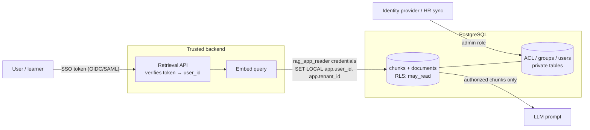

# Enterprise RAG on Kubernetes Docs: Chunking and Role-Based Security

Testleaf FDE Program, Week 7 homework. The project ingests 30 official Kubernetes documentation pages, compares four chunking strategies, stores `BAAI/bge-small-en-v1.5` embeddings in PostgreSQL + pgvector, and enforces document permissions **inside the database retrieval path** with group membership and Row-Level Security (RLS). The goal is to prove that unauthorized chunks never reach retrieval results, and so can never reach an LLM.

> Sections marked _generated_ are refreshed by `python run_all.py` from the files in `results/`. Each one states which embedder produced it.

---

## 1. Quick start (Windows and macOS)

**Prerequisites:** Python 3.12, plus Docker Desktop **or** an existing PostgreSQL 15+ server with the pgvector extension. You need internet access once, to download the embedding model (~70 MB).

```bash
# 1. Database (skip if you already have PostgreSQL + pgvector)
docker compose up -d                      # PostgreSQL 16 + pgvector on port 5433

# 2. Configuration. Never commit .env
cp .env.example .env                      # Windows PowerShell: Copy-Item .env.example .env
#   then edit POSTGRES_SERVER_URL (admin account) and READER_PASSWORD

# 3. Python environment
python3.12 -m venv .venv && source .venv/bin/activate          # macOS
#   py -3.12 -m venv .venv ; .\.venv\Scripts\Activate.ps1        # Windows
python -m pip install --upgrade pip
python -m pip install -r requirements.txt

# 4. Everything, end to end (≈3–6 min on a laptop CPU)
python run_all.py
```

`run_all.py` runs these steps, which you can also run one at a time:

| Step | Command | What it does |
|---|---|---|
| 0 (optional) | `python scripts/fetch_dataset.py --force` | Re-downloads the 30 Markdown files at the pinned commit (they are already committed under `data/k8s-docs/`) |
| 1 | `python bootstrap.py` | Creates the database, schema, RLS policies, the restricted retrieval role, groups and the 4 identities |
| 2 | `python ingest.py` | Cleans the docs, chunks them with all 4 strategies, embeds and stores chunks with metadata and ACLs |
| 3 | `python compare_chunking.py` | **Exercise A** → `results/chunking_comparison.md` |
| 4 | `python exercise_d.py` | **Exercise D** → `results/exercise_d.md` |
| 5 | `python test_security.py` | **Exercise E** → `results/exercise_e_security_tests.txt` |
| 6 | `python scripts/update_readme.py` | Copies the latest results into this README |

Ad-hoc retrieval as one identity:

```bash
python search.py --user meena --question "What are recommended Kubernetes RBAC practices?"
python search.py --user arjun --question "What are recommended Kubernetes RBAC practices?" --strategy recursive
```

**Offline fallback:** if HuggingFace is unreachable, set `EMBED_BACKEND=offline-lsa` in `.env`. That switches to a TF-IDF/SVD stand-in (`offline_embedder.py`) so you can still test the pipeline and all security checks. Results produced this way are labelled "OFFLINE-LSA stand-in (not BGE)" everywhere, and they are **not** the submission numbers.

### Repository layout

```
common.py             config, DB connections (admin vs restricted role), embeddings, identity helper
preprocess.py         Hugo front matter + shortcode cleanup → clean Markdown
chunkers.py           fixed / recursive / markdown-aware / semantic chunkers (exact source offsets)
bootstrap.py          database, schema, roles, grants, groups, identities
ingest.py             chunk + embed + store (all strategies, idempotent)
search.py             permission-aware cosine retrieval (RLS) - the only path a user query takes
compare_chunking.py   Exercise A metrics + labelled retrieval evaluation
exercise_d.py         Exercise D: same question, four identities, independent authorization check
test_security.py      Exercise E: negative tests, revocation, role hardening
sql/schema.sql        tables, SECURITY DEFINER ACL function, RLS policies
data/manifest.json    the 30 selected files: ID, category, ACL groups, path, URL, commit
data/users.json       groups and identities
data/eval_questions.json  21 labelled questions for the chunking evaluation
data/k8s-docs/        original Markdown files (CC BY 4.0, see NOTICE.md)
results/              generated evidence
```

---

## 2. Dataset

* **Source:** official Kubernetes documentation, [github.com/kubernetes/website](https://github.com/kubernetes/website), `content/en/docs/concepts/`, pinned at commit [`06fb965`](https://github.com/kubernetes/website/tree/06fb965bdd1b625352ed3d6af501b5fec1b425d4).
* **License and attribution:** © The Kubernetes Authors, [CC BY 4.0](https://creativecommons.org/licenses/by/4.0/). Files are stored unmodified under their original paths in `data/k8s-docs/` (see `data/k8s-docs/NOTICE.md`). Every chunk in the database links back to its `kubernetes.io` page and to the exact GitHub file at the pinned commit.
* **Access policy:** the department restrictions are **fictional** and exist only for this exercise.
* **Preprocessing (`preprocess.py`):** YAML front matter is parsed for `title` and `description` and removed from the body. Hugo shortcodes are rendered to plain text: `glossary_tooltip` becomes its text, `note`/`caution`/`warning` become **Note:** etc., `feature-state` becomes "(Feature state: …)", `highlight` becomes a fenced code block, and so on. HTML comments and heading anchors are removed, and Markdown links keep only their visible text. Headings, lists, tables and code fences are preserved.

| Access category | Kubernetes source area | Files | Group |
|---|---|---|---|
| Application Engineering | `concepts/workloads/` | 10 | `APP_ENG` |
| Platform Engineering | `concepts/storage/` | 10 | `PLATFORM_ENG` |
| Security Engineering | `concepts/security/` | 5 | `SECURITY_ENG` |
| Shared knowledge | `concepts/overview/` | 5 | `ALL_EMPLOYEES` |

<details><summary><b>Selected file list (30 files)</b> (generated)</summary>

<!-- AUTO:dataset -->
| ID | Access category | Permitted groups | Original file (source path) | Title | Published page |
|---|---|---|---|---|---|
| APP-01 | Application | APP_ENG | [`concepts/workloads/controllers/deployment.md`](https://github.com/kubernetes/website/blob/06fb965bdd1b625352ed3d6af501b5fec1b425d4/content/en/docs/concepts/workloads/controllers/deployment.md) | Deployments | [link](https://kubernetes.io/docs/concepts/workloads/controllers/deployment/) |
| APP-02 | Application | APP_ENG | [`concepts/workloads/controllers/replicaset.md`](https://github.com/kubernetes/website/blob/06fb965bdd1b625352ed3d6af501b5fec1b425d4/content/en/docs/concepts/workloads/controllers/replicaset.md) | ReplicaSet | [link](https://kubernetes.io/docs/concepts/workloads/controllers/replicaset/) |
| APP-03 | Application | APP_ENG | [`concepts/workloads/controllers/statefulset.md`](https://github.com/kubernetes/website/blob/06fb965bdd1b625352ed3d6af501b5fec1b425d4/content/en/docs/concepts/workloads/controllers/statefulset.md) | StatefulSets | [link](https://kubernetes.io/docs/concepts/workloads/controllers/statefulset/) |
| APP-04 | Application | APP_ENG | [`concepts/workloads/controllers/daemonset.md`](https://github.com/kubernetes/website/blob/06fb965bdd1b625352ed3d6af501b5fec1b425d4/content/en/docs/concepts/workloads/controllers/daemonset.md) | DaemonSet | [link](https://kubernetes.io/docs/concepts/workloads/controllers/daemonset/) |
| APP-05 | Application | APP_ENG | [`concepts/workloads/controllers/job.md`](https://github.com/kubernetes/website/blob/06fb965bdd1b625352ed3d6af501b5fec1b425d4/content/en/docs/concepts/workloads/controllers/job.md) | Jobs | [link](https://kubernetes.io/docs/concepts/workloads/controllers/job/) |
| APP-06 | Application | APP_ENG | [`concepts/workloads/controllers/cron-jobs.md`](https://github.com/kubernetes/website/blob/06fb965bdd1b625352ed3d6af501b5fec1b425d4/content/en/docs/concepts/workloads/controllers/cron-jobs.md) | CronJob | [link](https://kubernetes.io/docs/concepts/workloads/controllers/cron-jobs/) |
| APP-07 | Application | APP_ENG | [`concepts/workloads/pods/_index.md`](https://github.com/kubernetes/website/blob/06fb965bdd1b625352ed3d6af501b5fec1b425d4/content/en/docs/concepts/workloads/pods/_index.md) | Pods | [link](https://kubernetes.io/docs/concepts/workloads/pods/) |
| APP-08 | Application | APP_ENG | [`concepts/workloads/pods/pod-lifecycle.md`](https://github.com/kubernetes/website/blob/06fb965bdd1b625352ed3d6af501b5fec1b425d4/content/en/docs/concepts/workloads/pods/pod-lifecycle.md) | Pod Lifecycle | [link](https://kubernetes.io/docs/concepts/workloads/pods/pod-lifecycle/) |
| APP-09 | Application | APP_ENG | [`concepts/workloads/pods/init-containers.md`](https://github.com/kubernetes/website/blob/06fb965bdd1b625352ed3d6af501b5fec1b425d4/content/en/docs/concepts/workloads/pods/init-containers.md) | Init Containers | [link](https://kubernetes.io/docs/concepts/workloads/pods/init-containers/) |
| APP-10 | Application | APP_ENG | [`concepts/workloads/autoscaling/horizontal-pod-autoscale.md`](https://github.com/kubernetes/website/blob/06fb965bdd1b625352ed3d6af501b5fec1b425d4/content/en/docs/concepts/workloads/autoscaling/horizontal-pod-autoscale.md) | Horizontal Pod Autoscaling | [link](https://kubernetes.io/docs/concepts/workloads/autoscaling/horizontal-pod-autoscale/) |
| PLAT-01 | Platform | PLATFORM_ENG | [`concepts/storage/persistent-volumes.md`](https://github.com/kubernetes/website/blob/06fb965bdd1b625352ed3d6af501b5fec1b425d4/content/en/docs/concepts/storage/persistent-volumes.md) | Persistent Volumes | [link](https://kubernetes.io/docs/concepts/storage/persistent-volumes/) |
| PLAT-02 | Platform | PLATFORM_ENG | [`concepts/storage/volumes.md`](https://github.com/kubernetes/website/blob/06fb965bdd1b625352ed3d6af501b5fec1b425d4/content/en/docs/concepts/storage/volumes.md) | Volumes | [link](https://kubernetes.io/docs/concepts/storage/volumes/) |
| PLAT-03 | Platform | PLATFORM_ENG | [`concepts/storage/storage-classes.md`](https://github.com/kubernetes/website/blob/06fb965bdd1b625352ed3d6af501b5fec1b425d4/content/en/docs/concepts/storage/storage-classes.md) | Storage Classes | [link](https://kubernetes.io/docs/concepts/storage/storage-classes/) |
| PLAT-04 | Platform | PLATFORM_ENG | [`concepts/storage/dynamic-provisioning.md`](https://github.com/kubernetes/website/blob/06fb965bdd1b625352ed3d6af501b5fec1b425d4/content/en/docs/concepts/storage/dynamic-provisioning.md) | Dynamic Volume Provisioning | [link](https://kubernetes.io/docs/concepts/storage/dynamic-provisioning/) |
| PLAT-05 | Platform | PLATFORM_ENG | [`concepts/storage/volume-snapshots.md`](https://github.com/kubernetes/website/blob/06fb965bdd1b625352ed3d6af501b5fec1b425d4/content/en/docs/concepts/storage/volume-snapshots.md) | Volume Snapshots | [link](https://kubernetes.io/docs/concepts/storage/volume-snapshots/) |
| PLAT-06 | Platform | PLATFORM_ENG | [`concepts/storage/ephemeral-volumes.md`](https://github.com/kubernetes/website/blob/06fb965bdd1b625352ed3d6af501b5fec1b425d4/content/en/docs/concepts/storage/ephemeral-volumes.md) | Ephemeral Volumes | [link](https://kubernetes.io/docs/concepts/storage/ephemeral-volumes/) |
| PLAT-07 | Platform | PLATFORM_ENG | [`concepts/storage/projected-volumes.md`](https://github.com/kubernetes/website/blob/06fb965bdd1b625352ed3d6af501b5fec1b425d4/content/en/docs/concepts/storage/projected-volumes.md) | Projected Volumes | [link](https://kubernetes.io/docs/concepts/storage/projected-volumes/) |
| PLAT-08 | Platform | PLATFORM_ENG | [`concepts/storage/storage-capacity.md`](https://github.com/kubernetes/website/blob/06fb965bdd1b625352ed3d6af501b5fec1b425d4/content/en/docs/concepts/storage/storage-capacity.md) | Storage Capacity | [link](https://kubernetes.io/docs/concepts/storage/storage-capacity/) |
| PLAT-09 | Platform | PLATFORM_ENG | [`concepts/storage/volume-pvc-datasource.md`](https://github.com/kubernetes/website/blob/06fb965bdd1b625352ed3d6af501b5fec1b425d4/content/en/docs/concepts/storage/volume-pvc-datasource.md) | CSI Volume Cloning | [link](https://kubernetes.io/docs/concepts/storage/volume-pvc-datasource/) |
| PLAT-10 | Platform | PLATFORM_ENG | [`concepts/storage/storage-limits.md`](https://github.com/kubernetes/website/blob/06fb965bdd1b625352ed3d6af501b5fec1b425d4/content/en/docs/concepts/storage/storage-limits.md) | Node-specific Volume Limits | [link](https://kubernetes.io/docs/concepts/storage/storage-limits/) |
| SEC-01 | Security | SECURITY_ENG | [`concepts/security/rbac-good-practices.md`](https://github.com/kubernetes/website/blob/06fb965bdd1b625352ed3d6af501b5fec1b425d4/content/en/docs/concepts/security/rbac-good-practices.md) | Role Based Access Control Good Practices | [link](https://kubernetes.io/docs/concepts/security/rbac-good-practices/) |
| SEC-02 | Security | SECURITY_ENG | [`concepts/security/pod-security-standards.md`](https://github.com/kubernetes/website/blob/06fb965bdd1b625352ed3d6af501b5fec1b425d4/content/en/docs/concepts/security/pod-security-standards.md) | Pod Security Standards | [link](https://kubernetes.io/docs/concepts/security/pod-security-standards/) |
| SEC-03 | Security | SECURITY_ENG | [`concepts/security/secrets-good-practices.md`](https://github.com/kubernetes/website/blob/06fb965bdd1b625352ed3d6af501b5fec1b425d4/content/en/docs/concepts/security/secrets-good-practices.md) | Good practices for Kubernetes Secrets | [link](https://kubernetes.io/docs/concepts/security/secrets-good-practices/) |
| SEC-04 | Security | SECURITY_ENG | [`concepts/security/security-checklist.md`](https://github.com/kubernetes/website/blob/06fb965bdd1b625352ed3d6af501b5fec1b425d4/content/en/docs/concepts/security/security-checklist.md) | Security Checklist | [link](https://kubernetes.io/docs/concepts/security/security-checklist/) |
| SEC-05 | Security | SECURITY_ENG | [`concepts/security/multi-tenancy.md`](https://github.com/kubernetes/website/blob/06fb965bdd1b625352ed3d6af501b5fec1b425d4/content/en/docs/concepts/security/multi-tenancy.md) | Multi-tenancy | [link](https://kubernetes.io/docs/concepts/security/multi-tenancy/) |
| SHARED-01 | Shared | ALL_EMPLOYEES | [`concepts/overview/_index.md`](https://github.com/kubernetes/website/blob/06fb965bdd1b625352ed3d6af501b5fec1b425d4/content/en/docs/concepts/overview/_index.md) | Overview | [link](https://kubernetes.io/docs/concepts/overview/) |
| SHARED-02 | Shared | ALL_EMPLOYEES | [`concepts/overview/components.md`](https://github.com/kubernetes/website/blob/06fb965bdd1b625352ed3d6af501b5fec1b425d4/content/en/docs/concepts/overview/components.md) | Kubernetes Components | [link](https://kubernetes.io/docs/concepts/overview/components/) |
| SHARED-03 | Shared | ALL_EMPLOYEES | [`concepts/overview/kubernetes-api.md`](https://github.com/kubernetes/website/blob/06fb965bdd1b625352ed3d6af501b5fec1b425d4/content/en/docs/concepts/overview/kubernetes-api.md) | The Kubernetes API | [link](https://kubernetes.io/docs/concepts/overview/kubernetes-api/) |
| SHARED-04 | Shared | ALL_EMPLOYEES | [`concepts/overview/working-with-objects/_index.md`](https://github.com/kubernetes/website/blob/06fb965bdd1b625352ed3d6af501b5fec1b425d4/content/en/docs/concepts/overview/working-with-objects/_index.md) | Objects In Kubernetes | [link](https://kubernetes.io/docs/concepts/overview/working-with-objects/) |
| SHARED-05 | Shared | ALL_EMPLOYEES | [`concepts/overview/working-with-objects/namespaces.md`](https://github.com/kubernetes/website/blob/06fb965bdd1b625352ed3d6af501b5fec1b425d4/content/en/docs/concepts/overview/working-with-objects/namespaces.md) | Namespaces | [link](https://kubernetes.io/docs/concepts/overview/working-with-objects/namespaces/) |
<!-- /AUTO:dataset -->

</details>

---

## 3. Exercise A: chunking strategies

All four strategies run on the **same 30 cleaned documents**, and all four are stored side by side (`chunks.strategy`). Every chunk's text is an exact substring of its cleaned document at `start_char`. That makes every chunk traceable to its file and heading, whatever the strategy.

| Strategy | Implementation (`chunkers.py`) |
|---|---|
| **Fixed-size** | 1,000-character windows, 150-character overlap. Ignores all structure. |
| **Recursive** | LangChain-style: split on `\n## ` → `\n### ` → `\n#### ` → blank line → line → sentence → word until pieces fit 1,000 chars, then greedily merge with ~150 chars of overlap. |
| **Markdown structure-aware** | One section per heading (code fences respected). Sections under 200 chars (a heading with no body) are merged forward, so a heading never stands alone. Sections over 1,200 chars are split recursively with 100 chars of overlap. The **heading breadcrumb** (`Deployments > Rolling Back a Deployment`) is prepended to the text that is embedded and stored in `heading_path`. |
| **Semantic** | Units are sentences, list items, tables and code blocks, with a heading glued to the next unit. Each unit is embedded with ±1 neighbour; the chunker breaks where the cosine distance between adjacent windows exceeds that document's 85th percentile, within 300–1,200 chars. |

**How it was measured.** Structural metrics come straight from the stored chunks. Retrieval quality uses 21 hand-labelled questions (`data/eval_questions.json`, 4–7 per knowledge area, including the four Exercise D questions), each mapped to the document(s) that answer it. Metrics are hit@1, hit@5, MRR@5 and precision@5. This is an offline quality evaluation over **all** chunks (admin connection), so it isolates chunking from permissions.

### Comparison (generated)

<!-- AUTO:chunking -->
_Generated with embedder: **BAAI/bge-small-en-v1.5**. Full report: [results/chunking_comparison.md](results/chunking_comparison.md)_

| Metric | fixed | recursive | markdown | semantic |
|---|---|---|---|---|
| Total chunks | 662 | 713 | 755 | 684 |
| Avg / median size (chars) | 977 / 1000 | 806 / 856 | 737 / 757 | 806 / 863 |
| Min / max size (chars) | 161 / 1000 | 94 / 1000 | 57 / 1199 | 23 / 1200 |
| Avg / max tokens | 239 / 480 | 198 / 443 | 192 / 515 | 197 / 534 |
| Overlap configured / measured (chars) | 150 / 149 | 150 / 34 | 100 / 7 | 0 / 0 |
| Chunks starting at a heading | 0.5% | 37.2% | 62.9% | 10.4% |
| Embedded text carries its heading | 0.5% | 37.2% | 100.0% | 10.4% |
| Chunks spanning 2+ sections | 63.3% | 40.5% | 8.2% | 49.6% |
| Chunks ending mid-sentence | 76.6% | 8.0% | 7.3% | 4.7% |
| Chunks starting mid-sentence | 82.0% | 7.2% | 3.7% | 3.2% |
| Chunks cutting a code block | 13.6% | 2.1% | 1.9% | 1.5% |
| Retrieval hit@1 (21 labelled Qs) | **0.905** | 0.81 | **0.905** | **0.905** |
| Retrieval hit@5 (21 labelled Qs) | **1.0** | **1.0** | 0.952 | 0.952 |
| Retrieval MRR@5 (21 labelled Qs) | **0.929** | 0.883 | **0.929** | **0.929** |
| Retrieval precision@5 (21 labelled Qs) | 0.705 | 0.695 | **0.724** | **0.724** |

**Boundary examples** (extracted automatically; `‖` marks the chunk boundary):

- **fixed / good**: no clean boundary found (every boundary scanned was cut)
- **fixed / poor** (APP-01): _…ed, indicated by the '.metadata.name' field. This name will become the basis for the Repli_ **‖** _example: * A Deployment named 'nginx-deployment' is created, indicated by the '.metadata.n…_
- **recursive / good** (APP-01): _… opening an issue in the main Kubernetes repository if your use case is not covered below._ **‖** _## Use Case The following are typical use cases for Deployments: * Create a Deployment to …_
- **recursive / poor** (APP-01): _… labels, and in any existing Pods that the ReplicaSet might have. ## Updating a Deployment_ **‖** _## Updating a Deployment **Note:** A Deployment's rollout is triggered if and only if the …_
- **markdown / good** (APP-01): _… opening an issue in the main Kubernetes repository if your use case is not covered below._ **‖** _## Use Case The following are typical use cases for Deployments: * Create a Deployment to …_
- **markdown / poor** (APP-01): _…elector: app=nginx Replicas: 3 desired / 3 updated / 3 total / 3 available / 0 unavailable_ **‖** _Replicas: 3 desired / 3 updated / 3 total / 3 available / 0 unavailable StrategyType: Roll…_
- **semantic / good** (APP-01): _…icator that a rollout has stuck. * Clean up older ReplicaSets that you don't need anymore._ **‖** _## Creating a Deployment The following is an example of a Deployment. It creates a Replica…_
- **semantic / poor** (APP-01): _…Set: nginx-deployment-1564180365 (3/3 replicas created) Events: Type Reason Age From Messa_ **‖** _ge ---- ------ ---- ---- ------- Normal ScalingReplicaSet 2m deployment-controller Scale…_
<!-- /AUTO:chunking -->

### Recommendation: Markdown structure-aware chunking

For technical documentation, I recommend the **Markdown structure-aware** chunker, with recursive splitting only for oversized sections and the heading breadcrumb added to the embedded text. With BGE, **retrieval ranking was effectively a tie, so structure decides**:

1. **Retrieval does not separate the strategies.** On the 21 labelled questions, fixed, markdown and semantic all reached MRR@5 = 0.929 and hit@1 = 0.905. Recursive was lowest (0.883 / 0.81). One question is worth 0.048, so every difference is within one or two questions. Markdown and semantic had the best precision@5 (0.724 vs 0.705 for fixed and 0.695 for recursive), meaning more of the five returned chunks came from the right document. Fixed-size held up better than expected: with 1,000-char windows and 150 chars of overlap, most facts appear whole in at least one chunk. Markdown and semantic both missed the "clone a PVC" question (PLAT-09, a very short page) in their top 5, while fixed found it at rank 4.
2. **Heading preservation is total and by construction.** 100 % of markdown chunks carry their section heading in the embedded text, against 0.5 % for fixed, 37.2 % for recursive and 10.4 % for semantic. A paragraph such as *"Set `.spec.revisionHistoryLimit` …"* is only retrievable for "Deployment rollback" if the model can see it sits under *Deployments > Rolling Back a Deployment*.
3. **Chunks stay on one topic.** Only 8.2 % of markdown chunks span two sections, against 63.3 % (fixed), 49.6 % (semantic) and 40.5 % (recursive). A mixed chunk hands the LLM half-relevant context and makes citations vague.
4. **Clean boundaries for the LLM, not just the retriever.** Retrieval metrics only check that the right document is found. The LLM then has to read the chunk. 82 % of fixed chunks start mid-sentence and 76.6 % end mid-sentence (the example cuts "ReplicaSets" into "Repli" ‖ …), and 13.6 % cut a code block in half. Markdown has 0 % orphan headings, 3.7 % / 7.3 % mid-sentence starts/ends and 1.9 % split code blocks.
5. **Better attribution.** Each result can cite file + section (`heading_path`), which the source-reference requirement asks for.
6. **Cheap and deterministic.** Markdown chunking needs no model calls. Semantic chunking embedded ~4,100 extra sentence windows during ingestion for the same retrieval scores, and its boundaries change whenever the embedding model changes.

Recursive chunking is a reasonable baseline whenever documents have no Markdown structure. Fixed-size chunking is acceptable for recall but delivers the worst context to the LLM.

---

## 4. Exercise B: embeddings and pgvector storage

* **Model:** `BAAI/bge-small-en-v1.5` via `fastembed` (local ONNX, 384 dimensions, normalised). Passages are embedded as-is. Queries get the BGE retrieval instruction prefix (`Represent this sentence for searching relevant passages: `).
* **Storage:** `vector(384)` column. Ranking uses the cosine-distance operator `<=>` (0 = identical direction).

```text
raglab.documents      document_id, tenant_id, category, classification (restricted|shared), title, description,
                      file_name, source_path, source_url (kubernetes.io), github_url (file @ commit),
                      commit_sha, license, content_sha256, char_count, ingested_at          [RLS]
raglab.document_acl   document_id → group_name                                               [private]
raglab.groups         group_name, description                                                [private]
raglab.app_users      user_id, display_name, tenant_id, is_active                            [private]
raglab.user_groups    user_id → group_name, granted_at                                       [private]
raglab.chunks         chunk_id, document_id, tenant_id, strategy, chunk_no, heading_path,
                      chunk_text, embed_text, start_char, char_count, token_count,
                      embedding vector(384)                                                  [RLS]
```

The retrieval query (`search.py`) runs as the restricted role, inside a transaction that carries the caller's identity:

```sql
SELECT c.document_id, d.title, c.heading_path, d.source_url, d.github_url, d.classification,
       c.chunk_no, c.chunk_text, c.embedding <=> $query_vector AS distance
FROM raglab.chunks c
JOIN raglab.documents d USING (document_id)     -- also RLS-protected
WHERE c.strategy = 'markdown'
ORDER BY c.embedding <=> $query_vector
LIMIT 5;
```

Every result is ranked by distance and attributable to file, section and page. For example, `python search.py --user meena --question "What are recommended Kubernetes RBAC practices?"` prints, for each hit, the rank, document ID, cosine distance, `heading_path` (for example *Role Based Access Control Good Practices > Kubernetes RBAC - privilege escalation risks > Escalate verb*), the `kubernetes.io` URL and a text preview. Section 6 has the full ranked tables.

---

## 5. Exercise C: role-based access with PostgreSQL RLS

### Identities and memberships

| Employee | Groups | May retrieve |
|---|---|---|
| Priya | `APP_ENG`, `ALL_EMPLOYEES` | Application (APP-01…10) + shared (SHARED-01…05) |
| Arjun | `PLATFORM_ENG`, `ALL_EMPLOYEES` | Platform (PLAT-01…10) + shared |
| Meena | `SECURITY_ENG`, `ALL_EMPLOYEES` | Security (SEC-01…05) + shared |
| Divya | `APP_ENG`, `SECURITY_ENG`, `ALL_EMPLOYEES` | Application + Security + shared |

Document ACLs: restricted documents grant only their department group, and shared documents grant `ALL_EMPLOYEES`.

### Database roles

| Role | Used by | Privileges |
|---|---|---|
| Admin / owner (`POSTGRES_SERVER_URL`) | `bootstrap.py`, `ingest.py`, identity sync, test harness | Owns the schema; writes documents, ACLs and memberships. Never used on the query path. |
| `rag_app_reader` | The retrieval service (`search.py`) | `LOGIN NOSUPERUSER NOBYPASSRLS NOINHERIT`; `SELECT` on `chunks` and `documents` only (both under RLS); `EXECUTE` on `may_read()`; **no** access to `document_acl`, `user_groups`, `app_users`, `groups`; no INSERT/UPDATE/DELETE; cannot alter or drop policies |

### RLS policy

```sql
-- SECURITY DEFINER: evaluates private ACL tables the reader role cannot select
CREATE FUNCTION raglab.may_read(p_document_id text) RETURNS boolean
LANGUAGE sql STABLE SECURITY DEFINER SET search_path = pg_catalog, raglab AS $$
  SELECT EXISTS (SELECT 1 FROM documents d
                 JOIN document_acl a  ON a.document_id = d.document_id
                 JOIN user_groups ug ON ug.group_name = a.group_name
                 JOIN app_users u    ON u.user_id = ug.user_id
                 WHERE d.document_id = p_document_id AND u.is_active
                   AND u.user_id   = nullif(current_setting('app.user_id',   true), '')
                   AND d.tenant_id = nullif(current_setting('app.tenant_id', true), '')
                   AND u.tenant_id = d.tenant_id) $$;

ALTER TABLE raglab.chunks ENABLE ROW LEVEL SECURITY;
ALTER TABLE raglab.chunks FORCE  ROW LEVEL SECURITY;      -- owner is subject to it too
CREATE POLICY authorized_chunks ON raglab.chunks FOR SELECT
  USING (tenant_id = nullif(current_setting('app.tenant_id', true), '')
         AND raglab.may_read(document_id));
-- identical policy on raglab.documents, so titles/URLs of restricted docs are hidden as well
```

How it behaves:

* **Default deny.** No identity, an empty identity, an unknown user, an inactive user or a wrong tenant makes `may_read()` return false, so zero rows come back.
* **Filtering happens before ranking.** PostgreSQL applies the policy as part of the scan, so `ORDER BY embedding <=> … LIMIT 5` only ranks rows the caller may read. An unauthorized chunk is never ranked, returned, logged by the application or passed to an LLM. A department label in the prompt, or a post-retrieval filter in Python, would be weaker: both rely on application code being correct on every path, and post-filtering also silently shrinks the top-k.
* **Membership is evaluated live,** on every query. Revoking a group therefore takes effect on the next query, with no re-ingestion or re-embedding (proved in Exercise E).
* **Identity is transaction-scoped.** `set_config(..., true)` behaves like `SET LOCAL`, so the identity disappears at COMMIT. A pooled connection can't carry one user's identity into the next request (also tested).

### Trust boundary



* The database enforces **which rows** an identity may see. The trusted backend is responsible for **which identity** a request carries. The database trusts `app.user_id` from anyone who holds the `rag_app_reader` password. That is why the password lives only in the backend's secret store, and why users and learners never get database credentials or a SQL console.
* `--user` in `search.py` is a **local demo simulation** of the identity that a production backend would take from a verified token. In production it would be removed.
* Admin credentials are used only by bootstrap, ingestion and identity synchronisation, never on the query path. `.env` is git-ignored, and `.env.example` contains placeholders only.

---

## 6. Exercise D: same question, different results (generated)

Each question is run as all four identities using the recommended `markdown` strategy. For every result, `exercise_d.py` records the document ID, heading, source link and cosine distance, and re-checks authorization against an **independent oracle** computed in Python from `users.json` × `manifest.json` (not by the database). It also records which highly relevant documents (from the unrestricted admin top-5) were withheld.

<!-- AUTO:exercise_d -->
_Top-5 document IDs per identity (duplicates = several chunks from the same document). Full tables with headings, source links and distances: [results/exercise_d.md](results/exercise_d.md)_

| Question | Priya | Arjun | Meena | Divya |
|---|---|---|---|---|
| How does a Kubernetes Deployment manage application replicas? | APP-01 (0.156), APP-01 (0.175), APP-02 (0.195) | SHARED-01 (0.216), SHARED-04 (0.216), SHARED-01 (0.217)<br>**withheld:** APP-01, APP-02, APP-10 | SHARED-01 (0.216), SHARED-04 (0.216), SHARED-01 (0.217)<br>**withheld:** APP-01, APP-02, APP-10 | APP-01 (0.156), APP-01 (0.175), APP-02 (0.195) |
| What are PersistentVolumes and PersistentVolumeClaims? | APP-03 (0.228), APP-03 (0.248), APP-03 (0.305)<br>**withheld:** PLAT-01, PLAT-02 | PLAT-01 (0.163), PLAT-01 (0.212), PLAT-01 (0.213)<br>**withheld:** APP-03 | SEC-05 (0.292), SEC-01 (0.298), SHARED-03 (0.369)<br>**withheld:** PLAT-01, PLAT-02, APP-03 | APP-03 (0.228), APP-03 (0.248), SEC-05 (0.292)<br>**withheld:** PLAT-01, PLAT-02 |
| What are recommended Kubernetes RBAC practices? | SHARED-01 (0.287), SHARED-01 (0.287), SHARED-01 (0.288)<br>**withheld:** SEC-01, SEC-04, SEC-03 | SHARED-01 (0.287), SHARED-01 (0.287), SHARED-01 (0.288)<br>**withheld:** SEC-01, SEC-04, SEC-03 | SEC-01 (0.142), SEC-04 (0.184), SEC-03 (0.214) | SEC-01 (0.142), SEC-04 (0.184), SEC-03 (0.214) |
| What are the main Kubernetes components? | SHARED-02 (0.138), SHARED-01 (0.176), SHARED-02 (0.189) | SHARED-02 (0.138), SHARED-01 (0.176), SHARED-02 (0.189) | SHARED-02 (0.138), SHARED-01 (0.176), SHARED-02 (0.189) | SHARED-02 (0.138), SHARED-01 (0.176), SHARED-02 (0.189) |

Top-3 shown with cosine distance. Unauthorized results returned: **0** (every result is re-checked against an independent ACL oracle).
<!-- /AUTO:exercise_d -->

What the results show:

* For the **shared** question (components), all four identities get identical results, because shared documents carry `ALL_EMPLOYEES`.
* For a **restricted** question, the best-matching documents appear only for members of the owning group (Divya appears with both APP and SEC). Everyone else gets the best *authorized* chunks instead, which are usually shared overview pages at noticeably larger cosine distances. Semantic relevance never overrides permissions.

---

## 7. Exercise E: negative tests and revocation (generated)

`python test_security.py`. Every check runs through the restricted role. The admin connection is used only to revoke or restore memberships (as an identity-provider sync would) and to fingerprint the `chunks` table (row count, max id, MD5 of all embeddings). The fingerprint proves revocation did not re-embed or re-ingest anything.

<!-- AUTO:exercise_e -->
```text
# Exercise E evidence - 2026-11-28T01:04:53
# strategy=markdown embedder=BAAI/bge-small-en-v1.5 target=SEC-01 question='What are recommended Kubernetes RBAC practices?'

## 1. Authorized vs unauthorized access to the same restricted document
PASS  Meena (SECURITY_ENG) retrieves SEC-01 in top-5 => True   (SEC-01, SEC-04, SEC-03, SEC-01, SEC-01)
PASS  Divya (APP_ENG+SECURITY_ENG) retrieves SEC-01 in top-5 => True
PASS  Arjun (PLATFORM_ENG) gets no SEC-* chunk in top-5 => False   (SHARED-01, SHARED-01, SHARED-01, SHARED-01, SHARED-01)
PASS  Priya (APP_ENG) gets no SEC-* chunk in top-5 => False
PASS  Arjun direct SELECT on SEC-01 chunks returns 0 rows => 0
PASS  Arjun cannot even see the title of SEC-01 => None
PASS  Meena sees SEC-01 title => Role Based Access Control Good Practices
PASS  Priya blocked from PLAT-01 (storage) => 0
PASS  Arjun reads PLAT-01 (storage) => True
PASS  Meena blocked from APP-01 (workloads) => 0
PASS  Priya reads SHARED-02 (all employees) => True
PASS  Arjun reads SHARED-02 (all employees) => True
PASS  Meena reads SHARED-02 (all employees) => True
PASS  Divya reads SHARED-02 (all employees) => True

## 2. Unknown, missing and forged identity context
PASS  Unknown identity 'mallory' sees 0 restricted chunks => 0
PASS  Unknown identity 'mallory' sees 0 shared chunks => 0
PASS  No app.user_id set -> 0 chunks => 0
PASS  Empty app.user_id -> 0 chunks => 0
PASS  Valid user but no tenant set -> 0 chunks => 0
PASS  Valid user with wrong tenant -> 0 chunks => 0
PASS  Unknown identity search returns nothing => 0
PASS  Identity does not leak to the next transaction on a pooled connection => (True, 0)

## 3. Revocation takes effect immediately, without re-embedding or re-ingesting
INFO  chunk table fingerprint before: rows=2814 max_id=5628 md5(embeddings)=46ce245be7f39922c0f732adf35df86e
PASS  Meena sees 0 SEC-01 chunks right after revocation => 0   (revoke + query in 14 ms)
PASS  Meena's RBAC search now returns no SEC-* chunk => False   (SHARED-01, SHARED-01, SHARED-01, SHARED-01, SHARED-01)
PASS  Meena still reads shared SHARED-02 (ALL_EMPLOYEES kept) => True
PASS  Divya (other SECURITY_ENG member) unaffected => True
PASS  Chunk table unchanged (no re-embedding / re-ingestion) => (2814, 5628, '46ce245be7f39922c0f732adf35df86e')
INFO  membership meena -> SECURITY_ENG restored

## 4. Restoring the legitimate membership restores access
PASS  Meena sees SEC-01 chunks again => True
PASS  Meena's RBAC search returns SEC-01 again => True

## 5. Deactivating an identity (leaver) removes all access, including shared
PASS  Deactivated Arjun sees 0 shared chunks => 0
PASS  Reactivated Arjun reads SHARED-02 again => True

## 6. The retrieval role cannot read or change the authorization data
PASS  SELECT raglab.document_acl refused => InsufficientPrivilege
PASS  SELECT raglab.user_groups refused => InsufficientPrivilege
PASS  SELECT raglab.app_users refused => InsufficientPrivilege
PASS  SELECT raglab.groups refused => InsufficientPrivilege
PASS  Self-grant INSERT INTO user_groups refused => InsufficientPrivilege
PASS  UPDATE chunks refused => InsufficientPrivilege
PASS  DELETE chunks refused => InsufficientPrivilege
PASS  ALTER TABLE ... DISABLE ROW LEVEL SECURITY refused => InsufficientPrivilege
PASS  DROP POLICY refused => InsufficientPrivilege
PASS  SET row_security=off cannot bypass RLS => InsufficientPrivilege

## 7. Documented trust boundary (informational)
INFO  The database trusts app.user_id from whoever holds the retrieval-role password. That is why the
INFO  password lives only in the trusted backend, which sets app.user_id from a verified token. Users never
INFO  get database credentials; --user in search.py is a local demo stand-in for that verified identity.

ALL CHECKS PASSED
```
<!-- /AUTO:exercise_e -->

---

## 8. Final reflection

### 1. Is semantic chunking always better than recursive or structure-aware chunking?

No. The evidence from this corpus with `bge-small-en-v1.5`:

* **Retrieval: no gain.** Semantic chunking scored exactly the same as markdown structure-aware chunking on every metric (hit@1 0.905, hit@5 0.952, MRR@5 0.929, precision@5 0.724). Plain fixed-size chunking matched its MRR too. It beat recursive chunking (MRR 0.883), but only by about one question out of 21.
* **Cost: higher.** To get those identical scores it had to embed ~4,100 extra sentence windows at ingest time, more than the ~680 chunks it produced, by a factor of six. Its boundaries depend on the embedding model and the percentile threshold, so a model upgrade forces re-chunking, not just re-embedding.
* **Structure: worse.** Only 10.4 % of semantic chunks start at a heading and none carry a breadcrumb, against 100 % heading context for markdown. 49.6 % of semantic chunks span two sections, against 8.2 % for markdown. Topic shifts in embedding space are not the author's outline. Semantic chunking also produced the smallest fragment (23 chars) and still had to hard-split a long console table mid-word ("Messa" ‖ "ge"), because tables and code have no sentence structure.
* **Where it does help:** semantic chunking had the fewest mid-sentence boundaries (3.2 % / 4.7 %), and it is genuinely useful for unstructured prose such as transcripts, emails or OCR text, where no headings exist.
* **Conclusion:** when documents have explicit structure (Markdown, HTML, specs), structure-aware chunking captures the author's semantics for free, deterministically, and with better attribution. Semantic chunking should be judged on evidence per corpus, not assumed to be better.

### 2. If the most semantically relevant document is restricted, what should the retriever return?

It should return the **best authorized results only**, exactly as if the restricted document did not exist, and never the restricted chunk, its title, a snippet or its source URL. RLS on `documents` hides even the title. If no authorized chunk is relevant enough (above a distance threshold), the system should answer "I don't have information you're authorized to see on that", and it should not hint that a restricted document exists, because existence itself can leak information (for example a "Layoff plan Q3" title). Optionally, the system can offer a generic "request access" route that does not name the document, and the denial should be written to an audit log for security review. Exercise D shows this: Arjun's RBAC query returns shared overview chunks at larger distances, and SEC-01 never appears.

### 3. Why must permissions be enforced by the retrieval system instead of asking an LLM to respect them?

* **Once text is in the prompt, it has been disclosed.** The LLM is a text-completion system, not a security boundary. Prompt injection ("ignore previous instructions…"), jailbreaks, summarisation, translation or a simple model mistake can all surface restricted content. A label such as "do not reveal SEC documents" is only a request.
* **Non-determinism and no audit trail.** An LLM cannot guarantee the same refusal twice, and you cannot prove after the fact that it complied. A database policy is deterministic, testable (Exercise E has 40+ automated checks) and auditable.
* **Other leak paths.** Chunks also flow into logs, caches, traces, evaluation datasets and third-party LLM APIs. Filtering in the database before retrieval means unauthorized text never leaves PostgreSQL at all.
* **Least privilege and defence in depth.** The database is the single place where identity, group membership and document ACLs meet, and revocation there takes effect on the very next query. The LLM should only ever see what the user is already allowed to read.

---

## 9. Known limitations and proposed improvements

| Limitation | Improvement |
|---|---|
| `--user` simulates identity, and the DB trusts `app.user_id` from the reader role. | Put retrieval behind an API that validates OIDC/JWT tokens. Optionally have the DB verify a signed identity claim (HMAC/JWT in a `SECURITY DEFINER` function) or use per-request `SET ROLE` to per-user database roles. |
| Exact (sequential) vector scan, which is fine for ~3k chunks. | Add an HNSW index. With RLS, enable pgvector ≥0.8 iterative scans (`SET hnsw.iterative_scan = relaxed_order`) so filtered top-k is not under-filled, or partition by tenant. |
| `may_read()` is evaluated per row. | Cache the user's groups per transaction (e.g. `app.groups` set by a definer function) and store `allowed_groups text[]` on chunks with a GIN index for an `&&` test. |
| Bootstrap and ingest run with an admin/superuser account. | Use a dedicated non-superuser owner role for ingestion (the schema already has an `ingest_maintenance` policy for that) and secrets from a vault. |
| No audit log of retrievals or denials. | Insert an audit row per query (user, question hash, returned doc IDs) via a `SECURITY DEFINER` function. |
| Document-level ACLs only. | Section- or chunk-level labels, ABAC attributes (region, clearance), time-bound grants. |
| Chunking eval uses 21 hand-labelled questions with document-level relevance; one question = 0.048, so retrieval differences between strategies are not statistically meaningful. | A larger labelled set with section-level relevance, an LLM-as-judge answer evaluation, and hybrid (BM25 + vector) retrieval plus a reranker. |
| "What's next" link lists and code samples are referenced, not inlined. | Drop navigation boilerplate during preprocessing, and inline `code_sample` files from the repository. |
